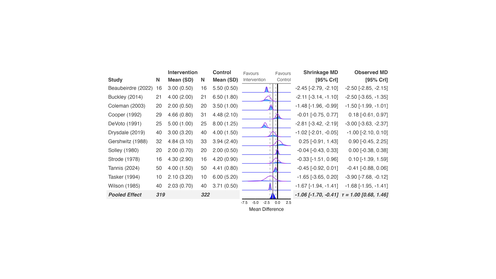

# Using bayesfoRest with bayesma

bayesma is a sister package in this same family, fitting meta-analysis
models via cmdstanr with a design that goes further than the other
backends in one respect: beyond plain random/common-effect models, it
has built-in publication-bias-adjustment model types (`"pet_peese"`,
`"bc_verde"`, `"bc_jung"`, `"copas"`, `"selection"`, `"mixture"`,
`"outlier"`) that fit directly through `bayesma()` itself, rather than
needing a separate RoBMA-style ensemble. Subgroup analyses and funnel
plots work the same way as the other backends.

## Fit the model

bayesma uses the same tidy-evaluation calling convention as
[`bayes_forest()`](https://blmoran.github.io/bayesfoRest/reference/bayes_forest.md)
– bare column names, not strings – and fits directly from the arm-level
data, no
[`metafor::escalc()`](https://wviechtb.github.io/metafor/reference/escalc.html)
step needed:

``` r

library(bayesma)
library(bayesfoRest)

model_bayesma <- bayesma(
  data = cont_outcome,
  measure = "MD",
  model_type = "random_effect",
  studyvar = Author,
  yearvar = Year,
  mean_ctrl = Mean_Control,
  mean_int = Mean_Intervention,
  sd_ctrl = SD_Control,
  sd_int = SD_Intervention,
  n_ctrl = N_Control,
  n_int = N_Intervention)
```

`measure` accepts `"OR"`, `"RR"`, `"IRR"`, `"MD"`, and `"SMD"`, and
determines which arguments are required – `mean_ctrl`/`mean_int`/
`sd_ctrl`/`sd_int` for `"MD"`/`"SMD"`, `event_ctrl`/`event_int` for
`"OR"`/`"RR"`/`"IRR"`. `mu_prior`/`tau_prior` take Stan prior
expressions directly (e.g. `"normal(0, 1)"`), rather than the `bf_*()`
constructors the other backends use.

## Create the forest plot

``` r

bayes_forest(
  model = model_bayesma,
  data = cont_outcome,
  measure = "MD",
  studyvar = Author,
  yearvar = Year,
  mean_ctrl = Mean_Control,
  mean_int = Mean_Intervention,
  sd_ctrl = SD_Control,
  sd_int = SD_Intervention,
  n_ctrl = N_Control,
  n_int = N_Intervention,
  xlim = c(-8, 3)
)
```



## Subgroup analysis

`subgroup = TRUE, subgroupvar = Subgroup` refits bayesma per subgroup
automatically, the same way it does for brms, bayesmeta, MetaStan, and
RoBMA.

## No `bf_*()` prior-sensitivity refit

bayesma doesn’t have a
[`sensitivity_plot()`](https://blmoran.github.io/bayesfoRest/reference/sensitivity_plot.md)/[`ecdf_model_plot()`](https://blmoran.github.io/bayesfoRest/reference/ecdf_model_plot.md)
refit method – its priors are plain Stan expression strings rather than
the single-distribution `bf_*()` objects those functions refit under, so
passing a bayesma model as the base `model` there will error. If you
want prior or model-type sensitivity for a bayesma analysis, compare
fits directly: refit `bayesma()` under each prior/`model_type` you want
to compare and build the comparison yourself, or fit your primary model
with one of the other backends and use bayesma for its
publication-bias-adjustment model types specifically.
