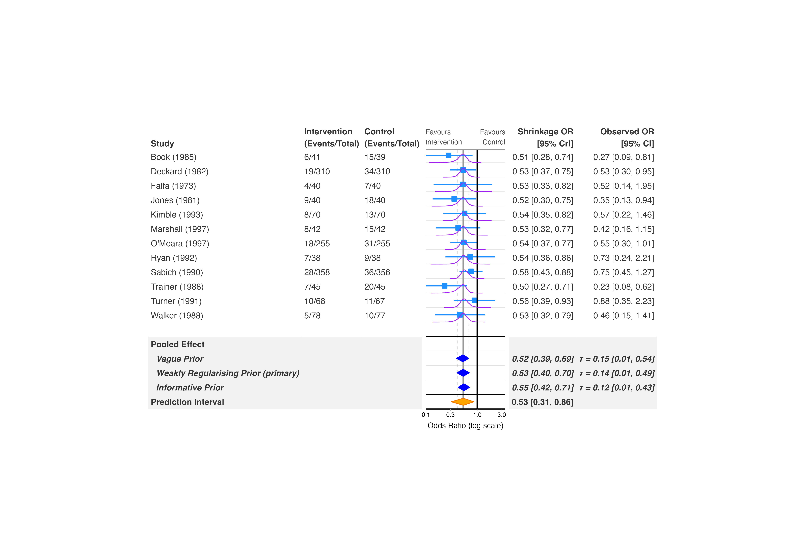
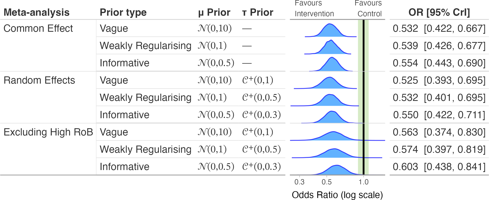
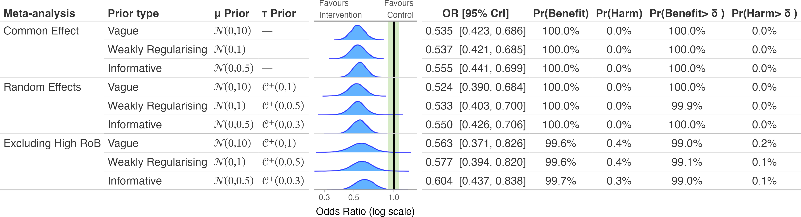
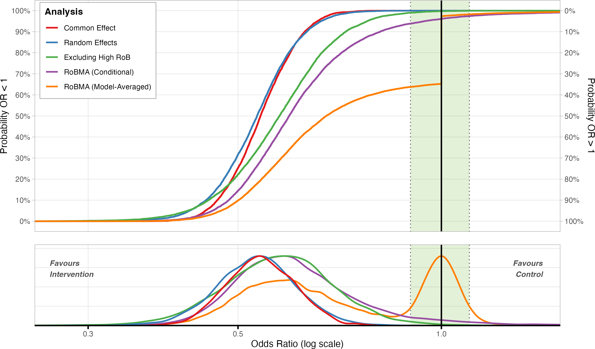
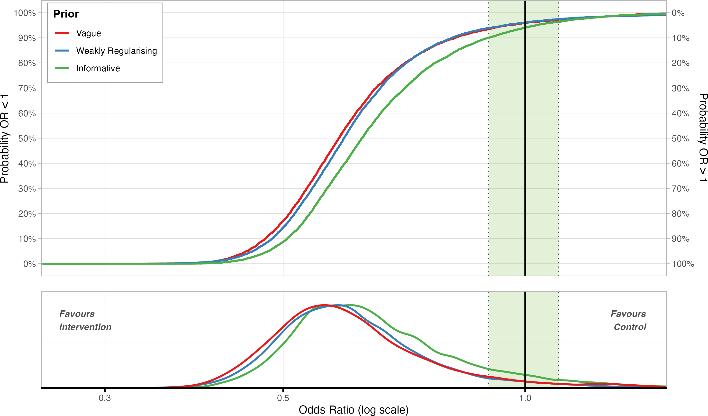

# Sensitivity Analysis

Bayesian meta-analyses depend on priors for the pooled effect () and,
for random-effects models, the heterogeneity (). bayesfoRest has four
functions for showing how sensitive your conclusions are to those
choices, plus to the broader modelling strategy (common- vs
random-effects, excluding high-risk-of-bias studies, publication-bias
adjustment):

- **[`forest_sens_plot()`](https://blmoran.github.io/bayesfoRest/reference/forest_sens_plot.md)**
  – a full forest plot, individual study rows and all, whose
  pooled-effect section shows one row per prior instead of a single
  estimate. Use this when you want the sensitivity comparison on the
  same plot as the underlying studies.
- **[`sensitivity_plot()`](https://blmoran.github.io/bayesfoRest/reference/sensitivity_plot.md)**
  – pooled estimates only, compared across both priors *and* model
  strategies (random- vs common-effect, RoB exclusion, RoBMA bias
  adjustment) at once, as rows of densities or boxplots.
- **[`ecdf_model_plot()`](https://blmoran.github.io/bayesfoRest/reference/ecdf_model_plot.md)**
  – cumulative-distribution comparison of model strategies for a single,
  fixed prior.
- **[`ecdf_prior_plot()`](https://blmoran.github.io/bayesfoRest/reference/ecdf_prior_plot.md)**
  – cumulative-distribution comparison of priors for a single, fixed
  model strategy.

All four take the same `priors` argument: a named list where each
element has `mu_prior`/`tau_prior` built from the `bf_*()` constructors
([`bf_normal()`](https://blmoran.github.io/bayesfoRest/reference/bf_priors.md),
[`bf_half_cauchy()`](https://blmoran.github.io/bayesfoRest/reference/bf_priors.md),
etc. – see
[`?bf_priors`](https://blmoran.github.io/bayesfoRest/reference/bf_priors.md)
for the full set and which backends can fit each one exactly). Refitting
under each prior works for `brmsfit`, `bayesmeta`, `meta_stan`, and
`brma` (a single
[`RoBMA::brma()`](https://fbartos.github.io/RoBMA/reference/brma.html)
fit, not a
[`RoBMA::RoBMA()`](https://fbartos.github.io/RoBMA/reference/RoBMA.html)
model-averaged ensemble) models; other backends raise an error naming
the unsupported model class.

## Fit a model and specify priors

This vignette uses `binary_outcome` and a random-effects brms model, the
same one used throughout the package’s other vignettes:

``` r

library(metafor)
library(brms)
library(bayesfoRest)

binary_es <- escalc(
  measure = "OR",
  ai = Event_Intervention, bi = Outcome_Intervention_No,
  ci = Event_Control, di = Outcome_Control_No,
  n1i = N_Intervention, n2i = N_Control,
  data = binary_outcome) |>
  dplyr::mutate(sei = sqrt(vi))

model_bin <- brm(
  yi | se(sei) ~ 1 + (1 | Author),
  family = gaussian(),
  data = binary_es,
  prior = prior(normal(0, 1), class = Intercept) +
          prior(cauchy(0, 0.5), class = sd),
  iter = 4000,
  cores = parallel::detectCores(),
  control = list(adapt_delta = 0.99),
  silent = 2)
```

Priors are written once with the `bf_*()` helpers and reused across
every function in this vignette:

``` r

priors <- list(
  vague = list(
    name      = "Vague",
    mu_prior  = bf_normal(0, 10),
    tau_prior = bf_half_cauchy(0, 1)),
  weakreg = list(
    name      = "Weakly Regularising",
    mu_prior  = bf_normal(0, 1),
    tau_prior = bf_half_cauchy(0, 0.5)),
  informative = list(
    name      = "Informative",
    mu_prior  = bf_normal(0, 0.5),
    tau_prior = bf_half_cauchy(0, 0.3))
)
```

## `forest_sens_plot()`: sensitivity on the forest plot itself

[`forest_sens_plot()`](https://blmoran.github.io/bayesfoRest/reference/forest_sens_plot.md)
draws the study rows exactly like
[`bayes_forest()`](https://blmoran.github.io/bayesfoRest/reference/bayes_forest.md),
then replaces the usual single “Pooled Effect” row with one row per
entry in `priors`, refitting `model_bin` under each. `primary_prior`
flags which prior the model was actually fit with by appending
“(primary)” to its row label; `show_prediction` (default `TRUE`) adds a
prediction-interval row below the priors, automatically dropped for
common-effect models since they have no :

``` r

forest_sens_plot(
  model = model_bin,
  data = binary_es,
  measure = "OR",
  studyvar = Author,
  yearvar = Year,
  n_ctrl = N_Control,
  n_int = N_Intervention,
  event_ctrl = Event_Control,
  event_int = Event_Intervention,
  priors = priors,
  primary_prior = "weakreg",
  study_output = "sq_whisker",
  pooled_output = "diamond",
  pred_output = "diamond",
  xlim = c(0.1, 3.5)
)
```



`study_output`/`pooled_output`/`pred_output` work the same way as in
[`bayes_forest()`](https://blmoran.github.io/bayesfoRest/reference/bayes_forest.md):
each one independently chooses `"density"`, `"boxplot"`, `"sq_whisker"`,
or (for `pooled_output`/`pred_output`) `"diamond"`.

## `sensitivity_plot()`: compare priors and model strategies together

[`sensitivity_plot()`](https://blmoran.github.io/bayesfoRest/reference/sensitivity_plot.md)
drops the study rows and instead lays out pooled estimates as rows, one
per prior *within* each model strategy you include. `incl_random_effect`
(default `TRUE`) keeps the base random-effects refits;
`incl_common_effect = TRUE` adds a common-effect refit under the same
priors; `exclude_high_rob = TRUE` adds a section excluding studies with
a high overall risk of bias (needs `rob_var`):

``` r

sensitivity_plot(
  model = model_bin,
  data = binary_es,
  priors = priors,
  measure = "OR",
  rob_var = Overall,
  exclude_high_rob = TRUE,
  incl_common_effect = TRUE,
  add_probs = FALSE,
  xlim = c(0.25, 1.5),
  add_null_range = TRUE
)
```



`add_probs = TRUE` adds columns for the posterior probability of benefit
and no-benefit relative to `null_value` (and to `null_range`, if an
`add_null_range`/ROPE is set):

``` r

sensitivity_plot(
  model = model_bin,
  data = binary_es,
  priors = priors,
  measure = "OR",
  rob_var = Overall,
  exclude_high_rob = TRUE,
  incl_common_effect = TRUE,
  add_probs = TRUE,
  xlim = c(0.25, 1.5),
  add_null_range = TRUE
)
```



### Adding publication-bias adjustment from RoBMA

`incl_robma`, `incl_pet_peese`, and `incl_selection_weight` add extra
sections built from a separately fitted RoBMA object, passed in as
`robma_fit` (a single fit, or a named list with one fit per prior
level):

``` r

sensitivity_plot(
  model = model_bin,
  data = binary_es,
  priors = priors,
  measure = "OR",
  robma_fit = model_robma,
  incl_robma = TRUE,
  incl_pet_peese = TRUE,
  incl_selection_weight = TRUE
)
```

This is separate from using a `brma` fit directly as the base `model` –
both are valid ways to bring RoBMA into a sensitivity analysis, and they
answer different questions. Passing `robma_fit` adds bias-adjusted
*sections* alongside your primary model’s own prior sensitivity. Passing
a `brma` fit as `model` instead refits *that* model under each prior,
the same way brms/bayesmeta/MetaStan do – useful when RoBMA’s
single-model fit (rather than its full model-averaged ensemble) is your
primary analysis. See
[`vignette("RoBMA")`](https://blmoran.github.io/bayesfoRest/articles/RoBMA.md)
for fitting details.

## `ecdf_model_plot()` and `ecdf_prior_plot()`: cumulative-distribution comparisons

Where
[`sensitivity_plot()`](https://blmoran.github.io/bayesfoRest/reference/sensitivity_plot.md)
shows every prior-by-strategy combination at once, the ECDF functions
fix one dimension and compare across the other, which reads more easily
when you only care about one axis of sensitivity at a time.

[`ecdf_model_plot()`](https://blmoran.github.io/bayesfoRest/reference/ecdf_model_plot.md)
fixes a single prior (`prior_to_plot`, or the first entry in `priors` by
default) and compares model strategies, coloured by section:

``` r

ecdf_model_plot(
  model = model_bin,
  data = binary_es,
  priors = priors["weakreg"],
  measure = "OR",
  rob_var = Overall,
  exclude_high_rob = TRUE,
  incl_common_effect = TRUE,
  xlim = c(0.25, 1.5),
  add_null_range = TRUE
)
```



[`ecdf_prior_plot()`](https://blmoran.github.io/bayesfoRest/reference/ecdf_prior_plot.md)
fixes a single section (`section_to_plot`, default `"All studies"`) and
compares priors instead, coloured by prior:

``` r

ecdf_prior_plot(
  model = model_bin,
  data = binary_es,
  priors = priors,
  measure = "OR",
  xlim = c(0.25, 1.5),
  add_null_range = TRUE
)
```



Both accept the same section toggles as
[`sensitivity_plot()`](https://blmoran.github.io/bayesfoRest/reference/sensitivity_plot.md)
(`exclude_high_rob`, `incl_pet_peese`, `incl_selection_weight`,
`incl_robma`, `robma_fit`) – set the one matching whichever section you
want included.

## Which function should I use?

| Question | Function |
|----|----|
| How sensitive is my pooled estimate to the prior, shown alongside the individual studies? | [`forest_sens_plot()`](https://blmoran.github.io/bayesfoRest/reference/forest_sens_plot.md) |
| How does the pooled estimate vary across priors *and* strategies (RE/CE, RoB exclusion, bias adjustment), side by side? | [`sensitivity_plot()`](https://blmoran.github.io/bayesfoRest/reference/sensitivity_plot.md) |
| For one prior, which strategy changes the conclusion most? | [`ecdf_model_plot()`](https://blmoran.github.io/bayesfoRest/reference/ecdf_model_plot.md) |
| For one strategy, which prior changes the conclusion most? | [`ecdf_prior_plot()`](https://blmoran.github.io/bayesfoRest/reference/ecdf_prior_plot.md) |

## Backend support

Refitting under `priors` only works for `brmsfit`, `bayesmeta`,
`meta_stan`, and `brma` models – see
[`?bf_priors`](https://blmoran.github.io/bayesfoRest/reference/bf_priors.md)
for the table of which prior families each of those four backends can
fit exactly (brms fits everything; bayesmeta and MetaStan each support a
narrower set). For `bayesma` models, which use plain Stan prior strings
rather than `bf_*()` objects, see
[`vignette("bayesma")`](https://blmoran.github.io/bayesfoRest/articles/bayesma.md)
for a manual alternative: refit `bayesma()` under each
prior/`model_type` yourself and compare the fits directly. `stanreg`,
`stanfit`, `CmdStanMCMC`, and `rjags` models aren’t supported by any of
the four functions in this vignette.
