# bayesfoRest: Forest Plots for Bayesian Meta Analyses in R

## Overview

bayesfoRest is an R package for creating publication-ready forest plots
from Bayesian meta-analyses. It provides a comprehensive solution for
visualizing meta-analytic results with support for various effect
measures, subgroup analyses, and risk of bias assessments.

## Key Features

- **Bayesian Forest Plots**: Create forest plots from models fitted with
  brms, bayesma, bayesmeta, MetaStan, rstanarm, rstan, cmdstanr, RoBMA
  or R2jags
- **Multiple Effect Measures**: Support for OR, HR, RR, IRR, MD, and SMD
- **Density or Boxplot Output**: Show study posteriors as densities or
  horizontal boxplots
- **Subgroup Analysis**: Built-in support for subgroup meta-analyses
- **Risk of Bias Integration**: Incorporate risk of bias assessments
  (RoB 2, ROBINS-I, ROBINS-E, QUADAS-2, CLARITY, ROB-NMA, PROBAST)
- **Shrinkage Visualisation**: Display shrinkage effects with density
  plots or point intervals
- **ROPE Support**: Add a Region of Practical Equivalence (ROPE) to
  plots
- **Extensive Customisation**: Colours, fonts, labels, and layout
- **Overall Plot**: Combined visualisation of the pooled effect,
  prediction and heterogeneity posterior distributions
- **Sensitivity Plot**: Create visualisations of different priors and
  model types, with probabilities of benefit/harm
- **ECDF Model Plot**: Plot comparing posterior distributions across
  different model strategies (e.g., random effects, comon-effect) under
  a single prior specification.
- **ECDF Prior Plot**: Plot comparing posterior distributions across
  different prior specifications for a single model type.
- **Risk of Bias Plots**: Traffic light plot or weighted bar chart of
  judgements per domain, standalone or weighted by study
- **Funnel Plot**: Study-level effect sizes plotted against precision.

## Installation

You can install the development version of bayesfoRest from GitHub:

``` r

# install.packages("remotes")
remotes::install_github("BLMoran/bayesfoRest")
```

## Basic Usage

The examples below use the `binary_outcome` dataset that comes with the
package. First prepare the effect sizes with metafor and fit a Bayesian
model (bayesma, RoBMA, bayesmeta, MetaStan; brms is shown here):

``` r

library(bayesfoRest)
library(metafor)
library(brms)

binary_es <- escalc(
  measure = "OR",
  ai = Event_Intervention, bi = Outcome_Intervention_No,
  ci = Event_Control, di = Outcome_Control_No,
  n1i = N_Intervention, n2i = N_Control,
  data = binary_outcome) |>
  dplyr::mutate(sei = sqrt(vi))

model_bin <- brm(
  yi | se(sei) ~ 1 + (1 | Author),
  family = gaussian(),
  data = binary_es,
  prior = prior(normal(0, 1), class = Intercept) +
          prior(cauchy(0, 0.5), class = sd),
  iter = 4000,
  control = list(adapt_delta = 0.99))
```

### Binary Outcome Forest Plot (Odds Ratio)

Assign the model object, data frame, and measure, then the study-level
arguments as unquoted column names, within
[`bayes_forest()`](https://blmoran.github.io/bayesfoRest/reference/bayes_forest.md):

``` r

bayes_forest(
  model = model_bin,
  data = binary_es,
  measure = "OR",
  studyvar = Author,
  yearvar = Year,
  n_ctrl = N_Control,
  n_int = N_Intervention,
  event_ctrl = Event_Control,
  event_int = Event_Intervention,
  xlim = c(0.1, 3.5)
)
```

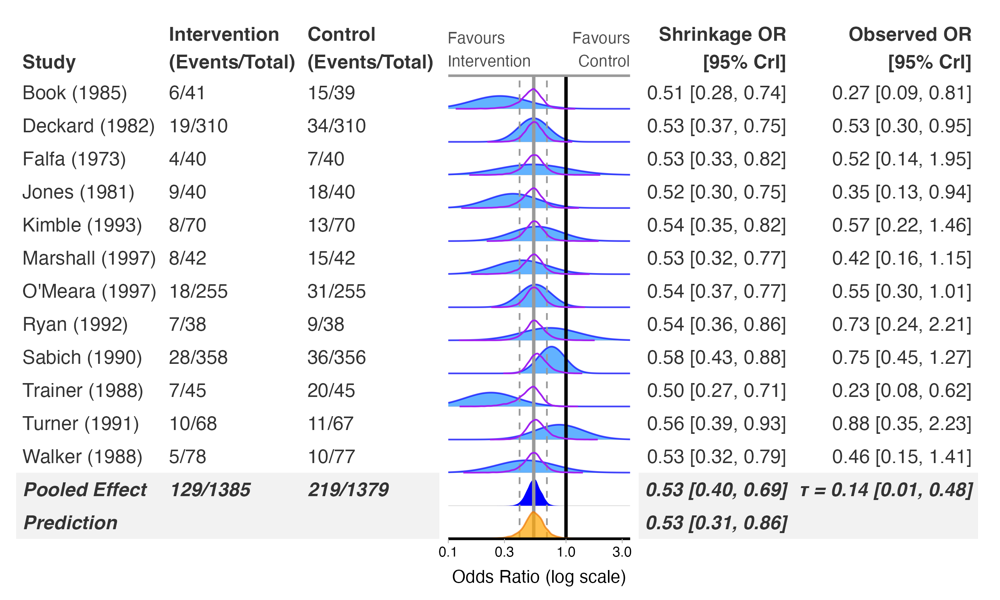

For continuous outcomes, use `mean_ctrl`, `mean_int`, `sd_ctrl` and
`sd_int` instead of the event columns. For time-to-event and rate
outcomes, use `time_ctrl` and `time_int`.

### Common-Effect Meta-Analysis

For a fixed/common-effect analysis, fit a model without a study-level
random effect (drop `(1 | Author)` in brms).
[`bayes_forest()`](https://blmoran.github.io/bayesfoRest/reference/bayes_forest.md)
auto-detects the pooling type from the model, so no shrinkage or
heterogeneity (tau) panel is drawn, and prediction intervals are
unavailable (there’s no tau to predict a new study from).

``` r

model_bin_ce <- brm(
  yi | se(sei) ~ 1,
  family = gaussian(),
  data = binary_es,
  prior = prior(normal(0, 1), class = Intercept),
  iter = 4000,
  control = list(adapt_delta = 0.99))

bayes_forest(
  model = model_bin_ce,
  model_type = "common_effect",
  data = binary_es,
  measure = "OR",
  studyvar = Author,
  yearvar = Year,
  n_ctrl = N_Control,
  n_int = N_Intervention,
  event_ctrl = Event_Control,
  event_int = Event_Intervention,
  xlim = c(0.1, 3.5)
)
```

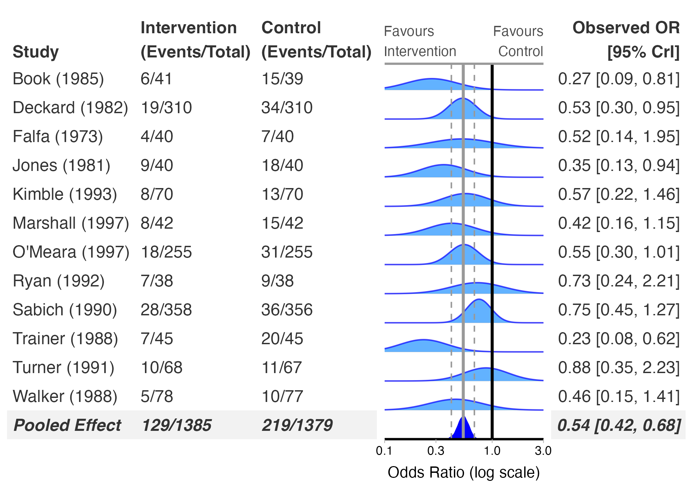

### Boxplot Output

`plot_output = "boxplot"` draws each study as a horizontal boxplot.
Shrinkage estimates are shown as point intervals.

``` r

bayes_forest(
  model = model_bin,
  data = binary_es,
  measure = "OR",
  studyvar = Author,
  yearvar = Year,
  n_ctrl = N_Control,
  n_int = N_Intervention,
  event_ctrl = Event_Control,
  event_int = Event_Intervention,
  plot_output = "boxplot",
  xlim = c(0.1, 3.5)
)
```

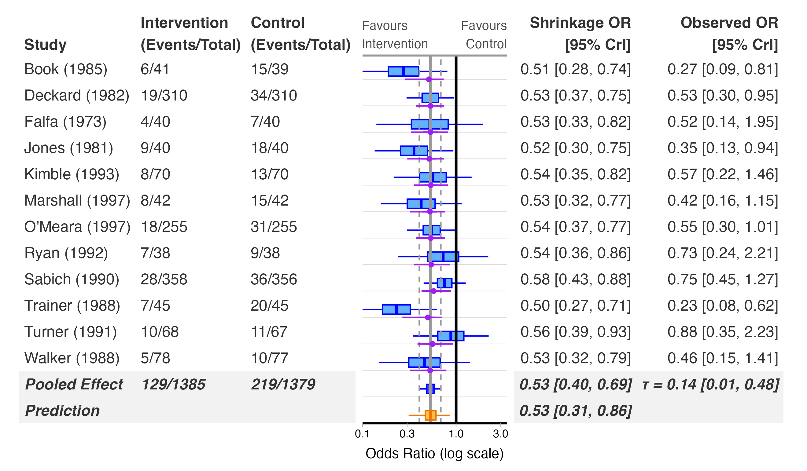

### Add Subgroups

``` r

bayes_forest(
  model = model_bin,
  data = binary_es,
  measure = "OR",
  studyvar = Author,
  yearvar = Year,
  n_ctrl = N_Control,
  n_int = N_Intervention,
  event_ctrl = Event_Control,
  event_int = Event_Intervention,
  subgroup = TRUE,
  subgroupvar = Subgroup,
  xlim = c(0.1, 3.5)
)
```

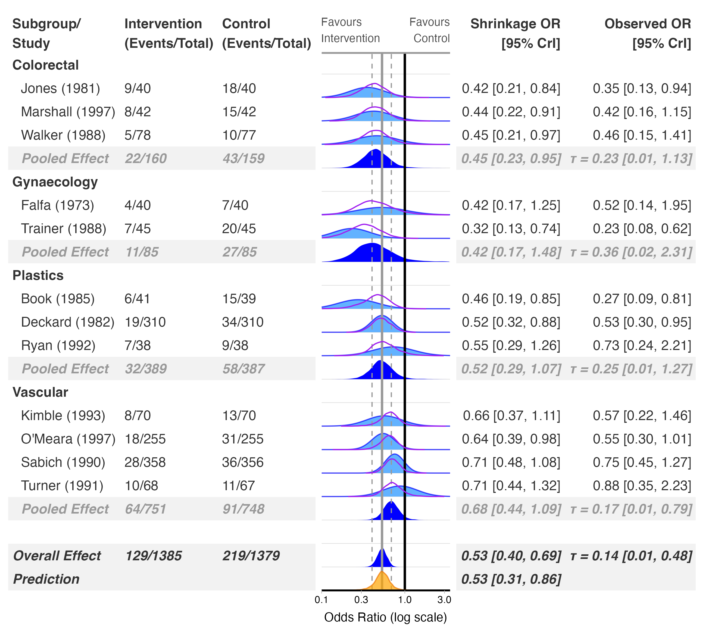

### Add Risk of Bias Columns

``` r

bayes_forest(
  model = model_bin,
  data = binary_es,
  measure = "OR",
  studyvar = Author,
  yearvar = Year,
  n_ctrl = N_Control,
  n_int = N_Intervention,
  event_ctrl = Event_Control,
  event_int = Event_Intervention,
  subgroup = TRUE,
  subgroupvar = Subgroup,
  add_rob = TRUE,
  xlim = c(0.1, 3.5)
)
```

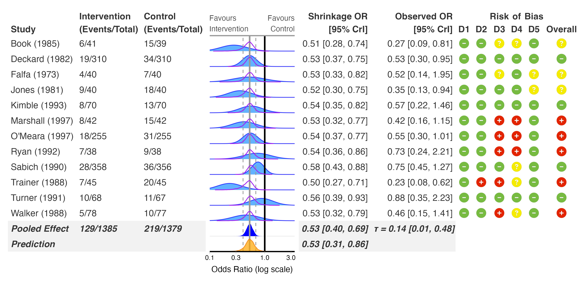

### Add Risk of Bias Legend

``` r

bayes_forest(
  model = model_bin,
  data = binary_es,
  measure = "OR",
  studyvar = Author,
  yearvar = Year,
  n_ctrl = N_Control,
  n_int = N_Intervention,
  event_ctrl = Event_Control,
  event_int = Event_Intervention,
  subgroup = TRUE,
  subgroupvar = Subgroup,
  add_rob = TRUE,
  add_rob_legend = TRUE,
  rob_tool = "rob2",
  xlim = c(0.1, 3.5)
)
```

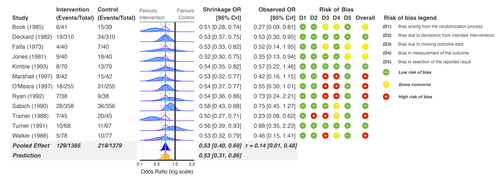

### Exclude Studies with High Risk of Bias

``` r

bayes_forest(
  model = model_bin,
  data = binary_es,
  measure = "OR",
  studyvar = Author,
  yearvar = Year,
  n_ctrl = N_Control,
  n_int = N_Intervention,
  event_ctrl = Event_Control,
  event_int = Event_Intervention,
  subgroup = TRUE,
  subgroupvar = Subgroup,
  add_rob = TRUE,
  add_rob_legend = TRUE,
  rob_tool = "rob2",
  exclude_high_rob = TRUE,
  xlim = c(0.1, 3.5)
)
```

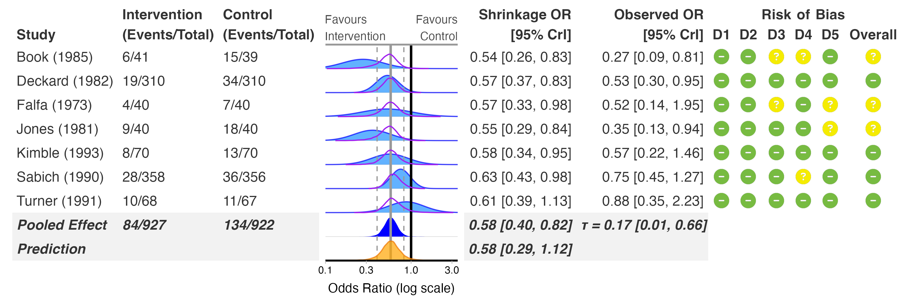

### Standalone Risk of Bias Plot

``` r

rob_plot(
  data = binary_outcome,
  studyvar = Author,
  yearvar = Year,
  rob_tool = "rob2",
  add_rob_legend = TRUE
)
```

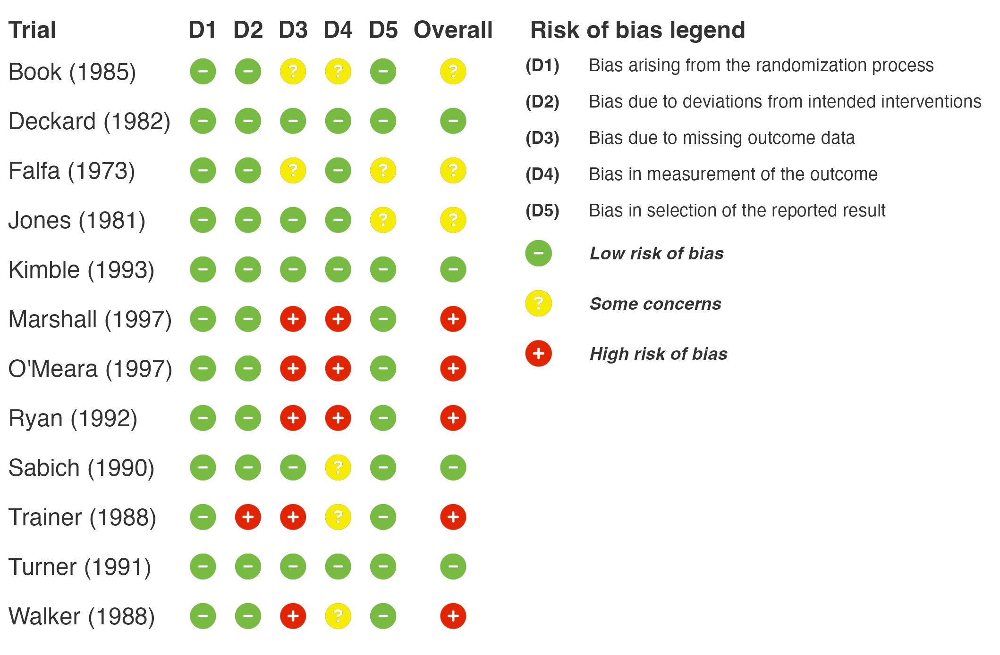

If your data has domain judgements but no overall column,
[`bayes_forest()`](https://blmoran.github.io/bayesfoRest/reference/bayes_forest.md)
and
[`rob_plot()`](https://blmoran.github.io/bayesfoRest/reference/rob_plot.md)
derive one automatically using the tool’s rules.

### Risk of Bias Summary Plot

[`rob_summary()`](https://blmoran.github.io/bayesfoRest/reference/rob_summary.md)
shows the weighted proportion of studies at each judgement, per domain,
as a stacked bar chart.

``` r

rob_summary(
  data = binary_outcome,
  rob_tool = "rob2",
  title = "Risk of Bias Summary"
)
```

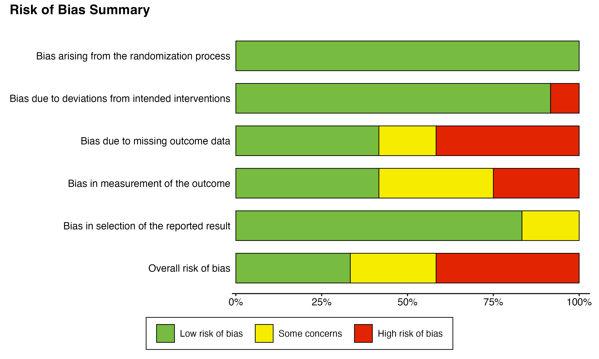

### Overall Plot

``` r

overall_plot(
  model = model_bin,
  data = binary_es,
  measure = "OR",
  add_tau = TRUE,
  add_pred = TRUE,
  incl_mu_prior = TRUE,
  incl_tau_prior = TRUE,
  add_null_range = TRUE,
  mu_xlim = c(0.1, 3.5),
  tau_xlim = c(0, 1.5),
  plot_arrangement = "vertical"
)
```

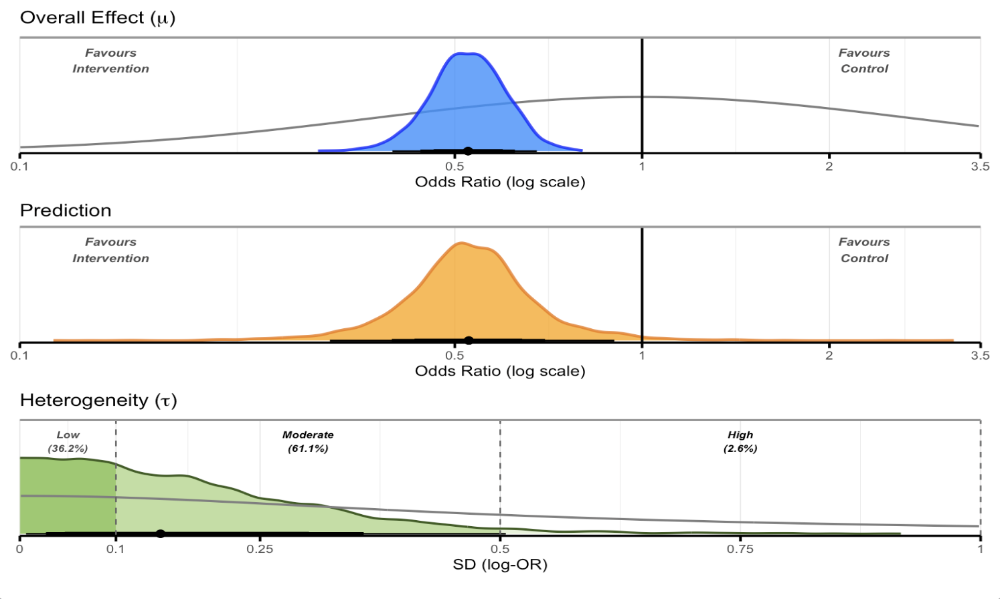

The dashed lines are the priors, drawn on the same density scale as the
posteriors. They are read from brms and bayesmeta models; for other
backends, pass them with `mu_prior` and `tau_prior` (e.g.
`mu_prior = bf_normal(0, 1)`). With `add_null_range = TRUE` the shaded
region defaults to an odds ratio of 0.9 to 1.1; set your own with
`null_range`.

### Funnel Plot

``` r

funnel_plot(
  model = model_bin,
  data = binary_es,
  measure = "OR",
  studyvar = Author,
  yearvar = Year,
  yi_col = "yi",
  sei_col = "sei",
  label_studies = TRUE
)
```

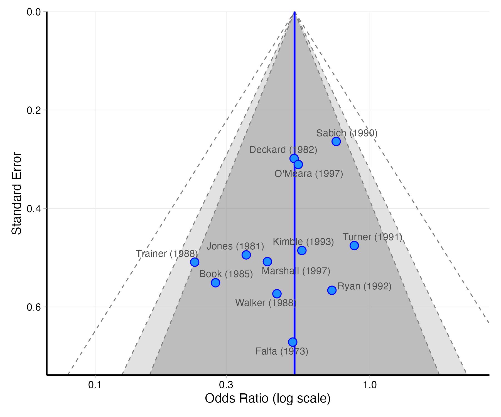

### Sensitivity Plot

Priors are written with the `bf_*()` helpers, so the same list works
whichever backend the model was fitted with. For the pooled effect use
[`bf_normal()`](https://blmoran.github.io/bayesfoRest/reference/bf_priors.md)
or
[`bf_student_t()`](https://blmoran.github.io/bayesfoRest/reference/bf_priors.md).
For the heterogeneity use
[`bf_half_normal()`](https://blmoran.github.io/bayesfoRest/reference/bf_priors.md),
[`bf_half_cauchy()`](https://blmoran.github.io/bayesfoRest/reference/bf_priors.md),
[`bf_half_t()`](https://blmoran.github.io/bayesfoRest/reference/bf_priors.md),
[`bf_exponential()`](https://blmoran.github.io/bayesfoRest/reference/bf_priors.md),
[`bf_lognormal()`](https://blmoran.github.io/bayesfoRest/reference/bf_priors.md)
or
[`bf_uniform()`](https://blmoran.github.io/bayesfoRest/reference/bf_priors.md),
or the empirical priors
[`bf_turner()`](https://blmoran.github.io/bayesfoRest/reference/bf_turner.md)
(binary outcomes) and
[`bf_rhodes()`](https://blmoran.github.io/bayesfoRest/reference/bf_turner.md)
(continuous outcomes), which are informative and especially useful when
there are few studies. If the model’s backend cannot fit a prior
exactly, you get an error rather than a substitute;
[`?bf_priors`](https://blmoran.github.io/bayesfoRest/reference/bf_priors.md)
lists which backends support which priors.

``` r

priors <- list(
  vague = list(
    name = "Vague",
    mu_prior = bf_normal(0, 10),
    tau_prior = bf_half_cauchy(0, 1)),
  weakreg = list(
    name = "Weakly Regularising",
    mu_prior = bf_normal(0, 1),
    tau_prior = bf_half_cauchy(0, 0.5)),
  informative = list(
    name = "Informative",
    mu_prior = bf_normal(0, 0.5),
    tau_prior = bf_half_cauchy(0, 0.3))
)

sensitivity_plot(
  model = model_bin,
  data = binary_es,
  priors = priors,
  measure = "OR",
  rob_var = Overall,
  exclude_high_rob = TRUE,
  incl_common_effect = TRUE,
  add_probs = FALSE,
  xlim = c(0.25, 1.5),
  add_null_range = TRUE
)
```

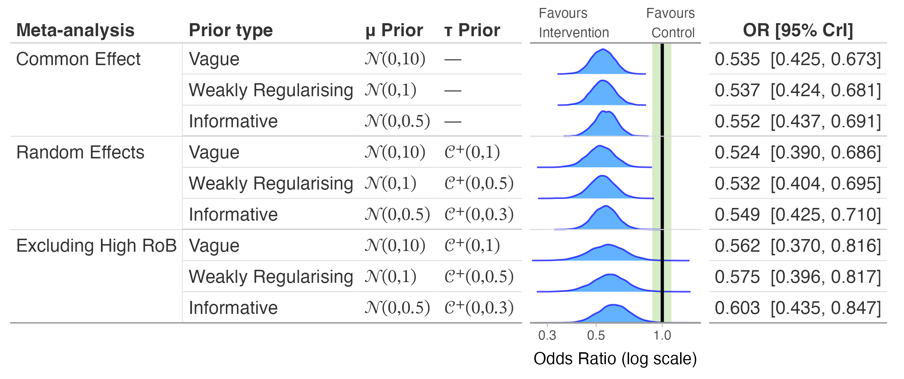

### Sensitivity Plot with Probabilities

``` r

sensitivity_plot(
  model = model_bin,
  data = binary_es,
  priors = priors,
  measure = "OR",
  rob_var = Overall,
  exclude_high_rob = TRUE,
  incl_common_effect = TRUE,
  add_probs = TRUE,
  xlim = c(0.25, 1.5),
  add_null_range = TRUE
)
```

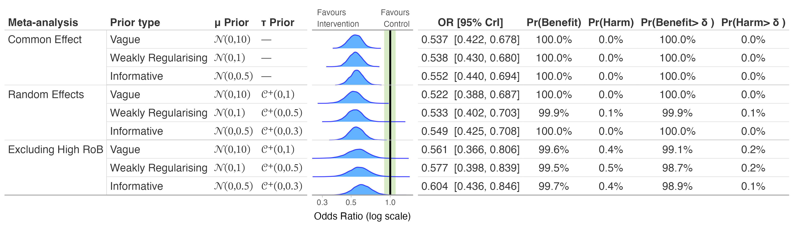

Publication-bias-adjusted models come from a RoBMA fit: pass it with
`robma_fit = your_robma_fit` and choose the components with
`incl_robma`, `incl_pet_peese` and `incl_selection_weight`.

### ECDF Plots

[`ecdf_model_plot()`](https://blmoran.github.io/bayesfoRest/reference/ecdf_model_plot.md)
compares the posterior of the pooled effect across models for one prior
set:

``` r

ecdf_model_plot(
  model = model_bin,
  data = binary_es,
  priors = priors["weakreg"],
  measure = "OR",
  rob_var = Overall,
  exclude_high_rob = TRUE,
  incl_common_effect = TRUE,
  xlim = c(0.25, 1.5),
  add_null_range = TRUE
)
```

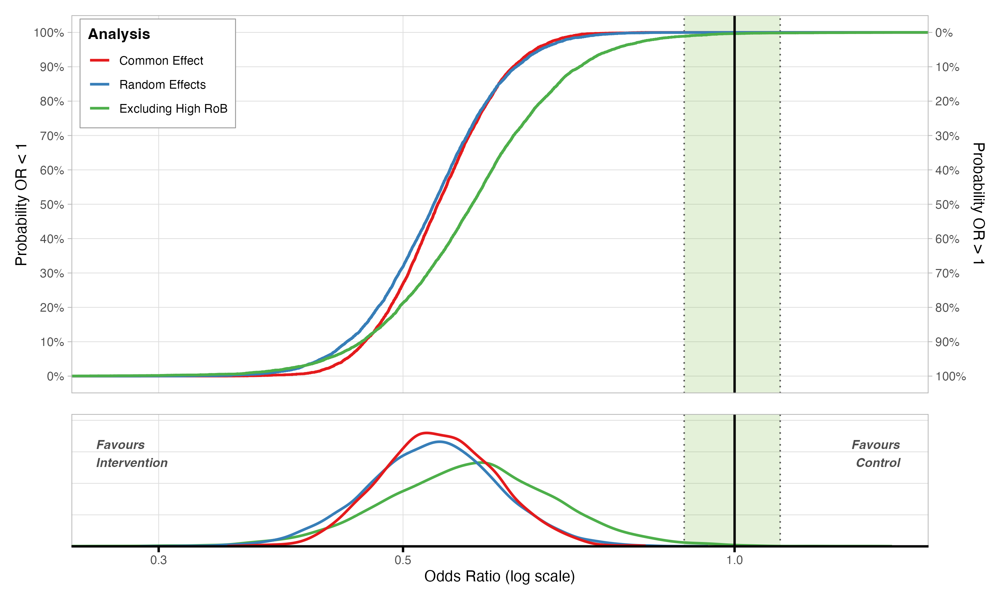

[`ecdf_prior_plot()`](https://blmoran.github.io/bayesfoRest/reference/ecdf_prior_plot.md)
compares it across prior sets for one model:

``` r

ecdf_prior_plot(
  model = model_bin,
  data = binary_es,
  priors = priors,
  measure = "OR",
  xlim = c(0.25, 1.5),
  add_null_range = TRUE
)
```

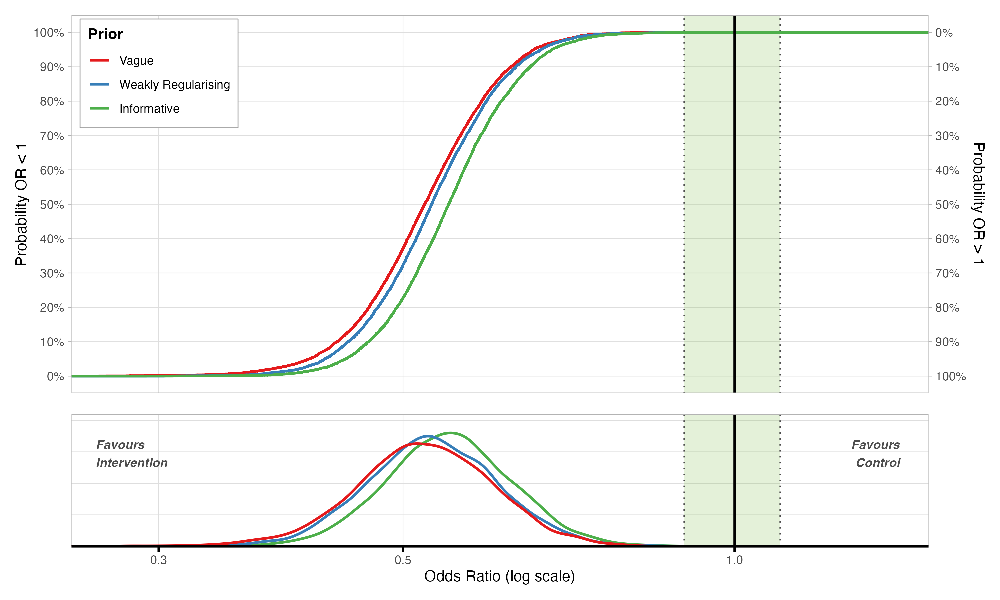

## Citation

If you use bayesfoRest in your research, please cite:

``` R
@Manual{,
  title = {bayesfoRest: Forest Plots for Bayesian Meta-Analyses in R},
  author = {[Benjamin Moran and Thomas Payne]},
  year = {2025},
  note = {R package version 0.0.0.9000},
  url = {https://github.com/BLMoran/bayesfoRest},
}
```

## Dependencies

bayesfoRest depends on several R packages:

- [metafor](https://wviechtb.github.io/metafor/index.html) for
  meta-analysis preparation (suggested)
- [brms](https://paulbuerkner.com/brms/),
  [bayesmeta](https://cran.r-project.org/package=bayesmeta),
  [MetaStan](https://cran.r-project.org/package=MetaStan),
  [RoBMA](https://fbartos.github.io/RoBMA/),
  [bayesma](https://blmoran.github.io/bayesma/) and other backends for
  Bayesian model fitting (suggested; install the ones you use)
- [gt](https://gt.rstudio.com) for creating tables
- [patchwork](https://patchwork.data-imaginist.com) for combining plots
- [ggplot2](https://ggplot2.tidyverse.org) for plotting
- [ggdist](https://mjskay.github.io/ggdist/) for density plotting
- [tidybayes](https://mjskay.github.io/tidybayes/index.html) for tidy
  workflow
- [dplyr](https://dplyr.tidyverse.org),
  [tidyr](https://tidyr.tidyverse.org),
  [purrr](https://purrr.tidyverse.org) for data manipulation
- [paletteer](https://emilhvitfeldt.github.io/paletteer/) for colour
  palettes
- [fontawesome](https://rstudio.github.io/fontawesome/) for risk of bias
  icons
- [posterior](https://mc-stan.org/posterior/) for working with posterior
  draws

## Feedback, Issues and Contributing

We welcome feedback, suggestions, issues and contributions. Please feel
free to contact either [Ben](mailto:ben.moran@newcastle.edu.au) or
[Tom](mailto:tompayne302@gmail.com) with any feedback. For any bugs,
please file it [here](https://github.com/BLMoran/bayesfoRest/issues)
with a minimal code example to reproduce the issue. Pull requests can be
made [here](https://github.com/BLMoran/bayesfoRest/pulls). Please note
that the bayesfoRest project is released with a [Contributor Code of
Conduct](https://github.com/BLMoran/bayesfoRest/CODE_OF_CONDUCT.html).
By contributing to this project, you agree to abide by its terms.

## License

This package is licensed under the AGPL-3 License.

## Acknowledgments

A special thanks to Matti Vuorre, whose [blog
post](https://vuorre.com/posts/bayesian-meta-analysis/index.html) as
well as [Doing Meta Analysis in R- Chapter 13: Bayesian
Meta-Analysis](https://doing-meta.guide/bayesian-ma) for being the
original inspiration for bayesfoRest.

bayesfoRest builds upon the excellent work of the
[brms](https://paulbuerkner.com/brms/),
[bayesmeta](https://cran.r-project.org/package=bayesmeta),
[MetaStan](https://cran.r-project.org/package=MetaStan),
[RoBMA](https://fbartos.github.io/RoBMA/), [Stan](https://mc-stan.org),
[metafor](https://wviechtb.github.io/metafor/index.html),
[gt](https://gt.rstudio.com),
[patchwork](https://patchwork.data-imaginist.com),
[ggdist](https://mjskay.github.io/ggdist/),
[tidybayes](https://mjskay.github.io/tidybayes/index.html) and the
[tidyverse](https://www.tidyverse.org) suite of packages. Without the
work of the R community and their contributions, bayesfoRest would not
be possible.
