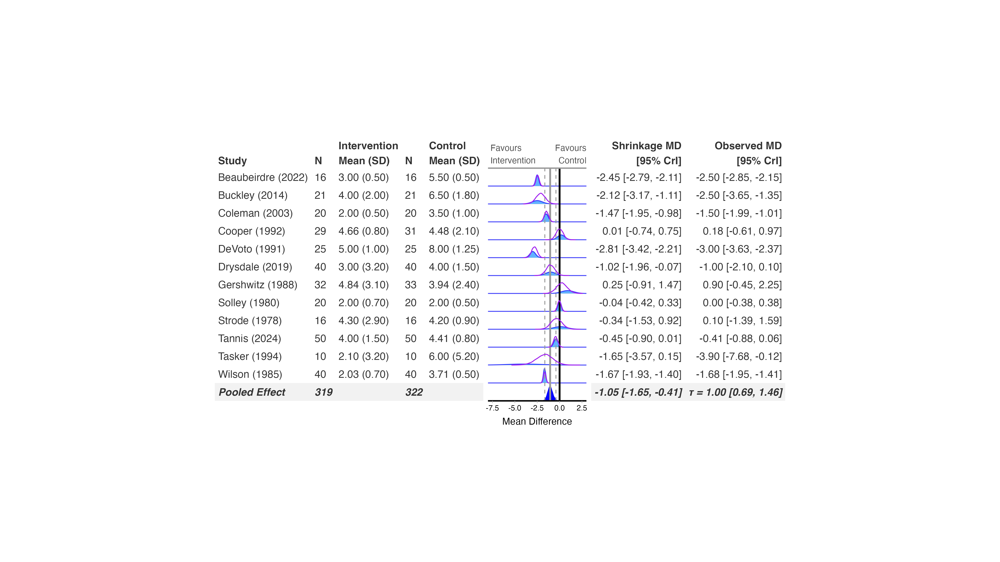

```{r, include = FALSE}
knitr::opts_chunk$set(
  collapse = TRUE,
  comment = "#>"
)
```

MetaStan fits meta-analysis models via Stan, with built-in support for
binomial, normal, and Poisson likelihoods. Like brms, it supports full
subgroup refitting and prior sensitivity. Subgroup analyses, prior
sensitivity, and funnel plots all work.

## Fit the model

Unlike brms and bayesmeta, MetaStan's `likelihood = "normal"` model
doesn't take a pre-computed effect size and standard error. It wants
**raw two-arm data**: each arm's mean and the standard error of that
mean (`sd / sqrt(n)`), the same way its binomial likelihood takes raw
responders/sample-size per arm rather than a log odds ratio. Data has
to go through `create_MetaStan_dat()` first, which reshapes
one-row-per-study data into one-row-per-arm:

```{r prepare, eval=FALSE}
library(MetaStan)
library(bayesfoRest)

dat <- as.data.frame(cont_outcome)
dat$nd  <- 2                                          # 2 arms per study
dat$M1  <- dat$Mean_Control
dat$SE1 <- dat$SD_Control / sqrt(dat$N_Control)        # arm 1 = control
dat$M2  <- dat$Mean_Intervention
dat$SE2 <- dat$SD_Intervention / sqrt(dat$N_Intervention)  # arm 2 = intervention

metastan_dat <- create_MetaStan_dat(
  dat,
  armVars  = c(mean = "M", std.err = "SE"),
  nArmsVar = "nd")

model_metastan <- meta_stan(
  data = metastan_dat,
  likelihood = "normal",
  theta_prior = c(0, 1),        # normal(mean, variance) prior on the treatment effect
  tau_prior = 0.5,
  tau_prior_dist = "half-normal",
  chains = 4,
  iter = 4000,
  warmup = 1000)
```

`theta_prior` (not `mu_prior`, which is for a binomial baseline-risk
term) must be specified explicitly for continuous outcomes -- MetaStan
errors if you leave it out.

## Create the forest plot

`bayes_forest()` still takes the *original* `cont_outcome` data frame,
not the arm-level `metastan_dat` -- the arm reshaping is only needed to
fit the model:

```{r forest, eval=FALSE}
bayes_forest(
  model = model_metastan,
  data = cont_outcome,
  measure = "MD",
  studyvar = Author,
  yearvar = Year,
  mean_ctrl = Mean_Control,
  mean_int = Mean_Intervention,
  sd_ctrl = SD_Control,
  sd_int = SD_Intervention,
  n_ctrl = N_Control,
  n_int = N_Intervention,
  xlim = c(-8, 3)
)
```

<p align="center">

</p>

## Subgroup analysis and prior sensitivity

Subgroup refits work the same way as brms: `subgroup = TRUE,
subgroupvar = Subgroup` refits MetaStan per subgroup automatically.

MetaStan also supports the full `bf_*()` prior-sensitivity workflow
(`sensitivity_plot()`, `ecdf_model_plot()`, `ecdf_prior_plot()`), with
one restriction: `bf_student_t()`, `bf_half_t()`, `bf_exponential()`,
`bf_lognormal()`/`bf_turner()`, and `bf_rhodes()` can't be fit exactly
by MetaStan (see `?bf_priors` for the full support table) -- you'll get
an error rather than a silent substitution if you try. `bf_normal()`,
`bf_half_normal()`, `bf_half_cauchy()`, and `bf_uniform()` all work.
See `vignette("brms")` for a worked sensitivity example and
`vignette("sensitivity-analysis")` for the full walkthrough.
