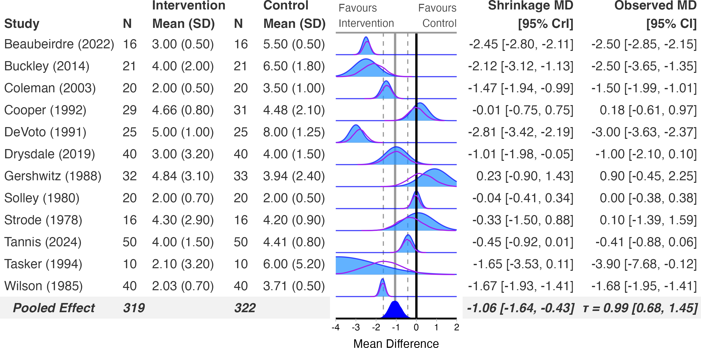

```{r, include = FALSE}
knitr::opts_chunk$set(
  collapse = TRUE,
  comment = "#>"
)
```

RoBMA is different in kind from the other backends. Rather than fitting
one random-effects model, it fits a *model-averaged ensemble* across
models with and without an effect, heterogeneity, and publication-bias
adjustment (selection models and PET-PEESE), then averages over them
weighted by their posterior model probability. The pooled estimate and
per-study shrinkage you get from `bayes_forest()` already reflect that
averaging -- there's no separate "turn on bias-adjustment" step.

## Fit the model

RoBMA takes effect sizes and sampling variances directly, computed with
`metafor::escalc()`, the same way bayesmeta does. One real constraint:
RoBMA's `measure` only accepts `"SMD"`, `"ZCOR"`, `"RR"`, `"OR"`,
`"HR"`, `"RD"`, `"IRR"`, or `"GEN"` -- there's no raw mean difference
option, so unlike the other continuous-outcome examples in this series
this one stays on the standardised scale:

```{r prepare, eval=FALSE}
library(metafor)
library(RoBMA)
library(bayesfoRest)

cont_es <- escalc(
  measure = "SMD",
  m1i = Mean_Intervention, sd1i = SD_Intervention, n1i = N_Intervention,
  m2i = Mean_Control, sd2i = SD_Control, n2i = N_Control,
  data = cont_outcome) |>
  dplyr::mutate(sei = sqrt(vi))

model_robma <- brma(data = cont_es,
                   yi = yi,
                   vi = vi,
                  measure = "SMD",
                  seed = 1234,
                  parallel = TRUE,
                  chains = 3,
                  sample = 5000,
                  burnin = 4000)
```


## Create the forest plot

```{r forest, eval=FALSE}
bayes_forest(
  model = model_robma,
  data = cont_outcome,
  measure = "SMD",
  studyvar = Author,
  yearvar = Year,
  mean_ctrl = Mean_Control,
  mean_int = Mean_Intervention,
  sd_ctrl = SD_Control,
  sd_int = SD_Intervention,
  n_ctrl = N_Control,
  n_int = N_Intervention,
  xlim = c(-6, 3)
)
```

<p align="center">

</p>

## Subgroup analysis and funnel plots

Subgroup refits work the same way as brms: `subgroup = TRUE,
subgroupvar = Subgroup` refits RoBMA per subgroup automatically.
`funnel_plot()` also works directly with a RoBMA model.

## Prior sensitivity -- two different roles for RoBMA

`model_robma` here is a `brma` fit (`RoBMA::brma()`, a single model with
`prior_effect`/`prior_heterogeneity`), not a `RoBMA::RoBMA()`
model-averaged ensemble, and it can be used as the primary `model` in
`forest_sens_plot()`, `sensitivity_plot()`, `ecdf_model_plot()`, and
`ecdf_prior_plot()` -- each `bf_*()` prior in your `priors` list is
translated to a `RoBMA::prior()` object and the model is refit under it,
the same way brms, bayesmeta, and MetaStan do. `bf_rhodes()`'s log-t
prior has no RoBMA/BayesTools equivalent and is the one family it can't
fit exactly; see `?bf_priors` for the full support table.

```{r sensitivity-robma-primary, eval=FALSE}
sensitivity_plot(
  model = model_robma,
  data = cont_es,
  priors = priors,
  measure = "SMD"
)
```

Separately, RoBMA is also the mechanism *other* backends use to add
publication-bias-adjusted sections to their own sensitivity analysis:
fit your main model with brms/bayesmeta/MetaStan as usual, then pass a
RoBMA fit alongside it as `robma_fit`:

```{r sensitivity-robma-section, eval=FALSE}
sensitivity_plot(
  model = model_re,          # a brms/bayesmeta/MetaStan fit
  data = binary_es,
  priors = priors,
  measure = "OR",
  robma_fit = model_robma,
  incl_robma = TRUE,
  incl_pet_peese = TRUE,
  incl_selection_weight = TRUE
)
```

These answer different questions: the first refits `model_robma` itself
under each prior; the second adds bias-adjusted *sections* alongside a
different primary model's own prior sensitivity. See
`vignette("sensitivity-analysis")` for the full walkthrough of both, plus
`forest_sens_plot()`, `ecdf_model_plot()`, and `ecdf_prior_plot()`.
