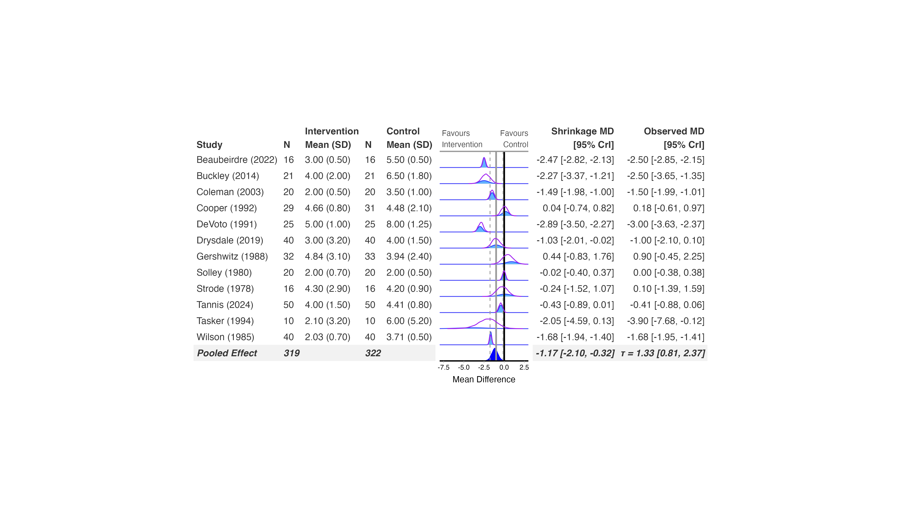

```{r, include = FALSE}
knitr::opts_chunk$set(
  collapse = TRUE,
  comment = "#>"
)
```

bayesmeta fits a random-effects meta-analysis by direct numerical
integration rather than MCMC, so there's no sampling to configure and
fits are close to instantaneous. It's always a random-effects model --
there's no common-effect option within bayesmeta itself. Subgroup
analyses, prior sensitivity, and funnel plots all work.

## Fit the model

bayesmeta works from a plain vector of effect sizes and standard
errors, computed with `metafor::escalc()`. This example uses the
continuous-outcome dataset and a (raw) mean difference:

```{r prepare, eval=FALSE}
library(metafor)
library(bayesmeta)
library(bayesfoRest)

cont_es <- escalc(
  measure = "MD",
  m1i = Mean_Intervention, sd1i = SD_Intervention, n1i = N_Intervention,
  m2i = Mean_Control, sd2i = SD_Control, n2i = N_Control,
  data = cont_outcome) |>
  dplyr::mutate(sei = sqrt(vi))

model_bayesmeta <- bayesmeta(
  y = cont_es$yi,
  sigma = cont_es$sei,
  labels = cont_es$Author,
  mu.prior.mean = 0, mu.prior.sd = 1,
  tau.prior = "uniform")
```

`tau.prior` accepts several built-in non-informative priors
(`"uniform"`, `"Jeffreys"`, `"DuMouchel"`, and others -- see
`?bayesmeta::bayesmeta`) or your own prior density as an R function.
`mu.prior.mean`/`mu.prior.sd` set a normal prior on the pooled effect;
leave them unset for an (improper) uniform prior.

## Create the forest plot

`bayes_forest()` takes the study-level `data` separately from the
fitted `model`, so pass the *original* `cont_outcome` data frame with
the arm-level means/SDs, not the `escalc()` output:

```{r forest, eval=FALSE}
bayes_forest(
  model = model_bayesmeta,
  data = cont_outcome,
  measure = "MD",
  studyvar = Author,
  yearvar = Year,
  mean_ctrl = Mean_Control,
  mean_int = Mean_Intervention,
  sd_ctrl = SD_Control,
  sd_int = SD_Intervention,
  n_ctrl = N_Control,
  n_int = N_Intervention,
  xlim = c(-8, 3)
)
```

<p align="center">

</p>

## Subgroup analysis, overall plot, and prior sensitivity

Subgroup refits work the same way as brms: `subgroup = TRUE,
subgroupvar = Subgroup` refits bayesmeta per subgroup automatically.

`overall_plot(incl_mu_prior = TRUE, incl_tau_prior = TRUE)` reads the
priors directly from the model (via `model$mu.prior`/`model$tau.prior`)
the same way it does for brms -- no need to re-specify them.

bayesmeta also supports the full `bf_*()` prior-sensitivity workflow
(`sensitivity_plot()`, `ecdf_model_plot()`, `ecdf_prior_plot()`),
refitting the model under each prior you specify. See
`vignette("brms")` for a worked sensitivity example and
`vignette("sensitivity-analysis")` for the full walkthrough -- the
calls are identical, just swap in a bayesmeta model.
