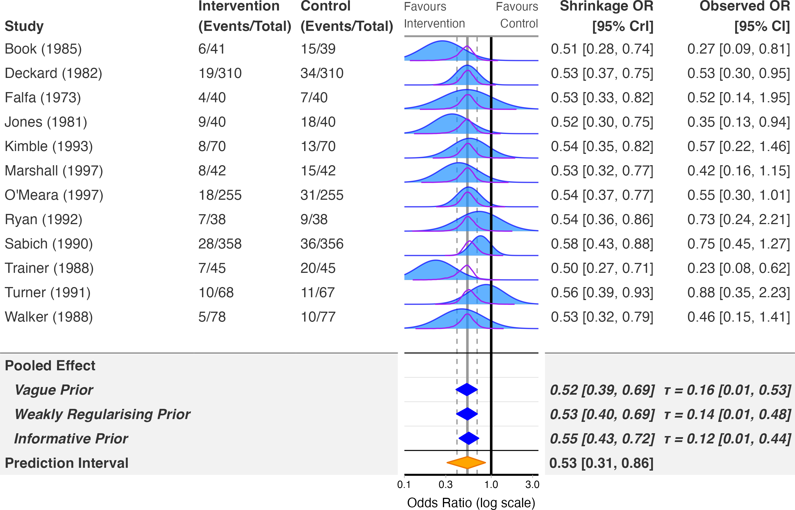
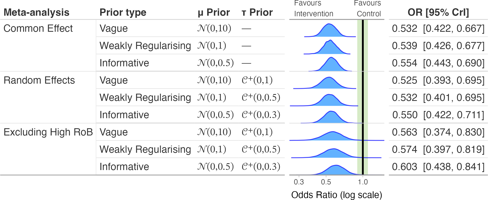
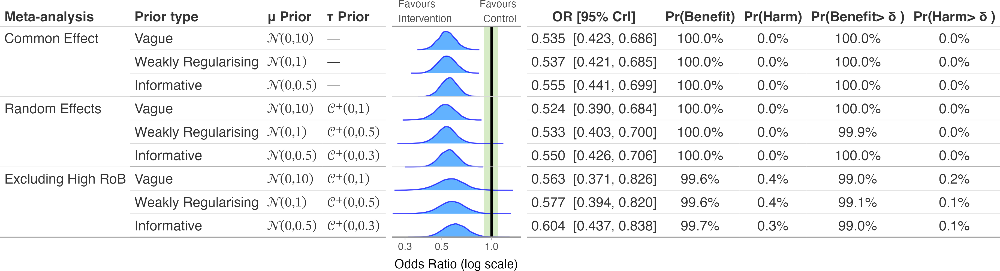
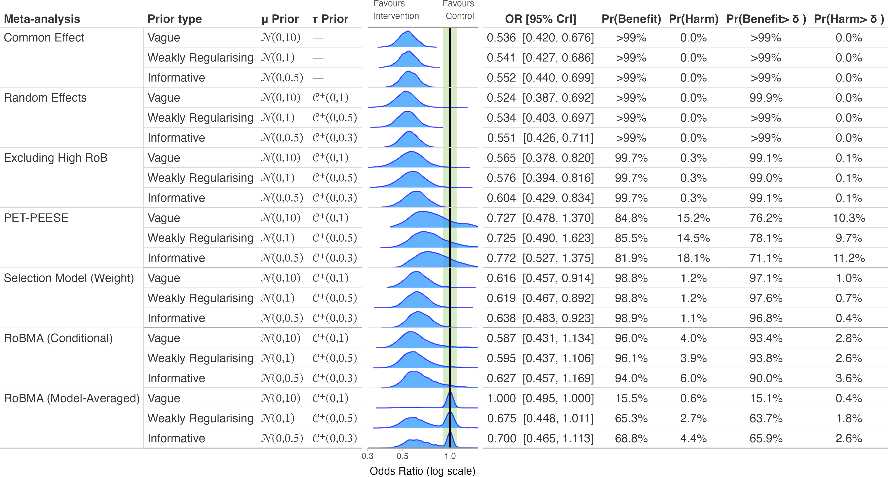
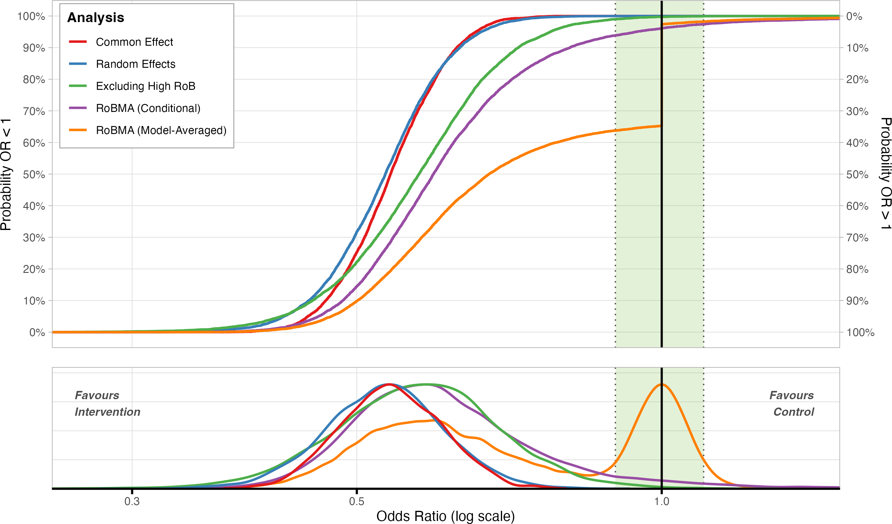
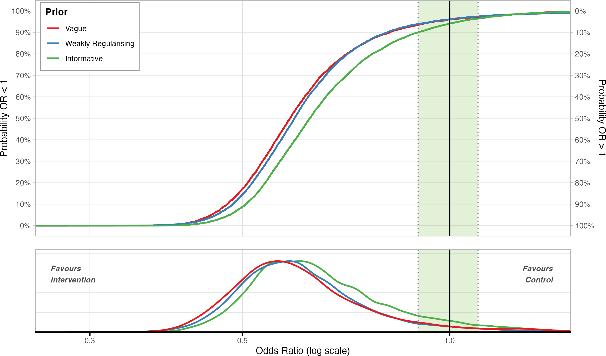

```{r, include = FALSE}
knitr::opts_chunk$set(
  collapse = TRUE,
  comment = "#>"
)
```

Bayesian meta-analyses depend on priors for the pooled effect
(\eqn{\mu}) and, for random-effects models, the heterogeneity
(\eqn{\tau}). bayesfoRest has four functions for showing how sensitive
your conclusions are to those choices, plus to the broader modelling
strategy (common- vs random-effects, excluding high-risk-of-bias
studies, publication-bias adjustment):

- **`forest_sens_plot()`** -- a full forest plot, individual study rows
  and all, whose pooled-effect section shows one row per prior instead
  of a single estimate. Use this when you want the sensitivity
  comparison on the same plot as the underlying studies.
- **`sensitivity_plot()`** -- pooled estimates only, compared across
  both priors *and* model strategies (random- vs common-effect, RoB
  exclusion, RoBMA bias adjustment) at once, as rows of densities or
  boxplots.
- **`ecdf_model_plot()`** -- cumulative-distribution comparison of model
  strategies for a single, fixed prior.
- **`ecdf_prior_plot()`** -- cumulative-distribution comparison of
  priors for a single, fixed model strategy.

All four take the same `priors` argument: a named list where each
element has `mu_prior`/`tau_prior` built from the `bf_*()` constructors
(`bf_normal()`, `bf_half_cauchy()`, etc. -- see `?bf_priors` for the
full set and which backends can fit each one exactly). Refitting under
each prior works for `brmsfit`, `bayesmeta`, `meta_stan`, and `brma` (a
single `RoBMA::brma()` fit, not a `RoBMA::RoBMA()` model-averaged
ensemble) models; other backends raise an error naming the unsupported
model class.

## Fit a model and specify priors

This vignette uses `binary_outcome` and a random-effects brms model, the
same one used throughout the package's other vignettes:

```{r prepare, eval=FALSE}
library(metafor)
library(brms)
library(bayesfoRest)

binary_es <- escalc(
  measure = "OR",
  ai = Event_Intervention, bi = Outcome_Intervention_No,
  ci = Event_Control, di = Outcome_Control_No,
  n1i = N_Intervention, n2i = N_Control,
  data = binary_outcome) |>
  dplyr::mutate(sei = sqrt(vi))

model_bin <- brm(
  yi | se(sei) ~ 1 + (1 | Author),
  family = gaussian(),
  data = binary_es,
  prior = prior(normal(0, 1), class = Intercept) +
          prior(cauchy(0, 0.5), class = sd),
  iter = 4000,
  cores = parallel::detectCores(),
  control = list(adapt_delta = 0.99),
  silent = 2)
```

Priors are written once with the `bf_*()` helpers and reused across
every function in this vignette:

```{r priors, eval=FALSE}
priors <- list(
  vague = list(
    name      = "Vague",
    mu_prior  = bf_normal(0, 10),
    tau_prior = bf_half_cauchy(0, 1)),
  weakreg = list(
    name      = "Weakly Regularising",
    mu_prior  = bf_normal(0, 1),
    tau_prior = bf_half_cauchy(0, 0.5)),
  informative = list(
    name      = "Informative",
    mu_prior  = bf_normal(0, 0.5),
    tau_prior = bf_half_cauchy(0, 0.3))
)
```

## `forest_sens_plot()`: sensitivity on the forest plot itself

`forest_sens_plot()` draws the study rows exactly like `bayes_forest()`,
then replaces the usual single "Pooled Effect" row with one row per
entry in `priors`, refitting `model_bin` under each. `primary_prior`
flags which prior the model was actually fit with by appending
"(primary)" to its row label; `show_prediction` (default `TRUE`) adds a
prediction-interval row below the priors, automatically dropped for
common-effect models since they have no \eqn{\tau}:

```{r forest-sens, eval=FALSE}
forest_sens_plot(
  model = model_bin,
  data = binary_es,
  measure = "OR",
  study_var = Author,
  year_var = Year,
  n_ctrl = N_Control,
  n_int = N_Intervention,
  event_ctrl = Event_Control,
  event_int = Event_Intervention,
  priors = priors,
  primary_prior = "weakreg",
  study_output = "sq_whisker",
  pooled_output = "diamond",
  pred_output = "diamond",
  xlim = c(0.1, 3.5)
)
```

<p align="center">



</p>

`study_output`/`pooled_output`/`pred_output` work the same way as in
`bayes_forest()`: each one independently chooses `"density"`,
`"boxplot"`, `"sq_whisker"`, or (for `pooled_output`/`pred_output`)
`"diamond"`.

## `sensitivity_plot()`: compare priors and model strategies together

`sensitivity_plot()` drops the study rows and instead lays out pooled
estimates as rows, one per prior *within* each model strategy you
include. `incl_random_effect` (default `TRUE`) keeps the base
random-effects refits; `incl_common_effect = TRUE` adds a common-effect
refit under the same priors; `exclude_high_rob = TRUE` adds a section
excluding studies with a high overall risk of bias (needs `rob_var`):

```{r sensitivity-plot, eval=FALSE}
sensitivity_plot(
  model = model_bin,
  data = binary_es,
  priors = priors,
  measure = "OR",
  rob_var = Overall,
  exclude_high_rob = TRUE,
  incl_common_effect = TRUE,
  add_probs = FALSE,
  xlim = c(0.25, 1.5),
  add_null_range = TRUE
)
```

<p align="center">



</p>

`add_probs = TRUE` adds columns for the posterior probability of benefit
and no-benefit relative to `null_value` (and to `null_range`, if an
`add_null_range`/ROPE is set):

```{r sensitivity-plot-probs, eval=FALSE}
sensitivity_plot(
  model = model_bin,
  data = binary_es,
  priors = priors,
  measure = "OR",
  rob_var = Overall,
  exclude_high_rob = TRUE,
  incl_common_effect = TRUE,
  add_probs = TRUE,
  xlim = c(0.25, 1.5),
  add_null_range = TRUE
)
```

<p align="center">



</p>

### Adding publication-bias adjustment from RoBMA

`incl_robma`, `incl_robma_bma`, `incl_pet_peese`, and
`incl_selection_weight` add extra sections built from a separately
fitted RoBMA object, passed in as `robma_fit` (a single fit, or a named
list with one fit per prior level -- here, one `RoBMA::RoBMA()` ensemble
per entry in `priors`, using the same \eqn{\mu}/\eqn{\tau}
specifications translated into `RoBMA::prior()` objects). `incl_robma`
and `incl_robma_bma` are independent -- see [What the RoBMA sections
show](#what-the-robma-sections-show) below for why you might want one
without the other:

```{r sensitivity-robma, eval=FALSE}
model_robma <- list(
  vague = RoBMA(
    data = binary_es, measure = "OR", yi = yi, sei = sei,
    prior_effect = RoBMA::prior("normal", list(mean = 0, sd = 10)),
    prior_heterogeneity = RoBMA::prior("cauchy", list(location = 0, scale = 1),
                                       truncation = list(lower = 0, upper = Inf)),
    model_type = "PSMA", seed = 1404),
  weakreg = RoBMA(
    data = binary_es, measure = "OR", yi = yi, sei = sei,
    prior_effect = RoBMA::prior("normal", list(mean = 0, sd = 1)),
    prior_heterogeneity = RoBMA::prior("cauchy", list(location = 0, scale = 0.5),
                                       truncation = list(lower = 0, upper = Inf)),
    model_type = "PSMA", seed = 1404),
  informative = RoBMA(
    data = binary_es, measure = "OR", yi = yi, sei = sei,
    prior_effect = RoBMA::prior("normal", list(mean = 0, sd = 0.5)),
    prior_heterogeneity = RoBMA::prior("cauchy", list(location = 0, scale = 0.3),
                                       truncation = list(lower = 0, upper = Inf)),
    model_type = "PSMA", seed = 1404)
)

sensitivity_plot(
  model = model_bin,
  data = binary_es,
  priors = priors,
  measure = "OR",
  rob_var = Overall,
  exclude_high_rob = TRUE,
  incl_common_effect = TRUE,
  robma_fit = model_robma,
  incl_robma = TRUE,
  incl_robma_bma = TRUE,
  incl_pet_peese = TRUE,
  incl_selection_weight = TRUE,
  add_probs = TRUE,
  xlim = c(0.1, 3.5),
  add_null_range = TRUE
)
```

<p align="center">



</p>

This is separate from using a `brma` fit directly as the base `model` --
both are valid ways to bring RoBMA into a sensitivity analysis, and they
answer different questions. Passing `robma_fit` adds bias-adjusted
*sections* alongside your primary model's own prior sensitivity. Passing
a `brma` fit as `model` instead refits *that* model under each prior,
the same way brms/bayesmeta/MetaStan do -- useful when RoBMA's
single-model fit (rather than its full model-averaged ensemble) is your
primary analysis. See `vignette("RoBMA")` for fitting details.

### What the RoBMA sections show {#what-the-robma-sections-show}

`incl_pet_peese` and `incl_selection_weight` each add one bias-adjusted
estimate per prior: the pooled effect conditional on that correction
method being the right one *and* on a real effect being present. These
are continuous, ordinary-looking posteriors, directly comparable to the
Common/Random Effects rows above them.

`incl_robma` and `incl_robma_bma` each add one further row per prior,
and they answer different questions -- which is why they're independent
toggles rather than a single on/off switch:

- **RoBMA (Conditional)**, `incl_robma` -- the pooled effect given that
  an effect exists. Like PET-PEESE/Selection Model above, this is
  continuous.
- **RoBMA (Model-Averaged)**, `incl_robma_bma` -- RoBMA's full
  posterior, averaged across *all* models in its ensemble, including the
  ones with no effect at all. If the data don't rule out "no effect",
  some of that posterior mass sits exactly on the null value
  (OR/RR/HR/IRR = 1, MD/SMD =
  0)  rather than being spread continuously -- a genuine feature of the
      result, not something to explain away.

A point mass like that can't be drawn with an ordinary density estimate
(it has zero width), so the Model-Averaged row's null-valued draws are
jittered by a small, deterministic amount before the usual density
estimate runs -- the same KDE as every other row, just fed slightly
perturbed input. The jitter width is set from that row's own continuous
draws, so the resulting spike is sized like a feature of that row's own
posterior rather than an arbitrary constant, and the displayed
spike-to-slab proportion falls straight out of the true draw counts,
with no separate scaling applied. `Pr(Benefit)`/`Pr(Harm)` (and their
`null_range` counterparts, shown when `add_probs = TRUE`) are computed
directly from the (unjittered) draws, so they remain the most direct
read on exactly how much posterior mass sits on each side of the null --
`>99%` rather than `100.0%`, since a continuous posterior probability is
never exactly one.

If a model-averaged row's spike makes the rest of that row hard to read
-- or, on the ECDF plots below, makes the whole curve hard to read once
the spike's jump dominates it -- that's a good reason to leave
`incl_robma_bma` off and rely on `incl_robma` (RoBMA Conditional) alone;
it's always continuous.

## `ecdf_model_plot()` and `ecdf_prior_plot()`: cumulative-distribution comparisons

Where `sensitivity_plot()` shows every prior-by-strategy combination at
once, the ECDF functions fix one dimension and compare across the other,
which reads more easily when you only care about one axis of sensitivity
at a time.

`ecdf_model_plot()` fixes a single prior (`prior`, one entry's worth of
spec -- not the whole `priors` list) and compares model strategies,
coloured by section. Because it only ever shows one prior, `robma_fit`
here is a single fitted RoBMA object rather than a named list:

This example includes both RoBMA sections (`incl_robma`, the continuous
conditional estimate, and `incl_robma_bma`, the model-averaged one that
can carry a point mass at the null) alongside Common/Random Effects and
Excluding High RoB, so you can see all of them on one plot:

```{r ecdf-model, eval=FALSE}
ecdf_model_plot(
  model = model_bin,
  data = binary_es,
  prior = priors$weakreg,
  measure = "OR",
  rob_var = Overall,
  exclude_high_rob = TRUE,
  incl_common_effect = TRUE,
  robma_fit = model_robma$weakreg,
  incl_robma = TRUE,
  incl_robma_bma = TRUE,
  xlim = c(0.25, 1.5),
  add_null_range = TRUE
)
```

<p align="center">



</p>

`ecdf_prior_plot()` fixes a single section (`section_to_plot`, default
`"Random Effects"`) and compares priors instead, coloured by prior.
Setting it to `"RoBMA (Conditional)"` compares how that RoBMA estimate
shifts across priors -- only `incl_robma` is needed here, since
`incl_robma_bma` would just build model-averaged draws that
`section_to_plot` then discards:

```{r ecdf-prior, eval=FALSE}
ecdf_prior_plot(
  model = model_bin,
  data = binary_es,
  priors = priors,
  measure = "OR",
  section_to_plot = "RoBMA (Conditional)",
  robma_fit = model_robma,
  incl_robma = TRUE,
  xlim = c(0.25, 1.5),
  add_null_range = TRUE
)
```

<p align="center">



</p>

Both accept the same section toggles as `sensitivity_plot()`
(`exclude_high_rob`, `incl_pet_peese`, `incl_selection_weight`,
`incl_robma`, `incl_robma_bma`, `robma_fit`) -- set the one matching
whichever section(s) you want included or displayed. The sections mean
the same thing as in `sensitivity_plot()` (see [What the RoBMA sections
show](#what-the-robma-sections-show) above): `RoBMA (Model-Averaged)`
(`incl_robma_bma`) can carry a point mass at the null, which the ECDF
panel shows correctly as a vertical jump; the optional density panel
below it (`show_density = TRUE`, the default) renders that same point
mass the same jittered-then-KDE way described above. If that makes
either panel hard to read, leave `incl_robma_bma` off and use
`incl_robma` (RoBMA Conditional) instead -- it's always continuous.

## Which function should I use?

| Question | Function |
|----|----|
| How sensitive is my pooled estimate to the prior, shown alongside the individual studies? | `forest_sens_plot()` |
| How does the pooled estimate vary across priors *and* strategies (RE/CE, RoB exclusion, bias adjustment), side by side? | `sensitivity_plot()` |
| For one prior, which strategy changes the conclusion most? | `ecdf_model_plot()` |
| For one strategy, which prior changes the conclusion most? | `ecdf_prior_plot()` |

## Backend support

Refitting under `priors` only works for `brmsfit`, `bayesmeta`,
`meta_stan`, and `brma` models -- see `?bf_priors` for the table of
which prior families each of those four backends can fit exactly (brms
fits everything; bayesmeta and MetaStan each support a narrower set).
For `bayesma` models, which use plain Stan prior strings rather than
`bf_*()` objects, see `vignette("bayesma")` for a manual alternative:
refit `bayesma()` under each prior/`model_type` yourself and compare the
fits directly. `stanreg`, `stanfit`, `CmdStanMCMC`, and `rjags` models
aren't supported by any of the four functions in this vignette.
